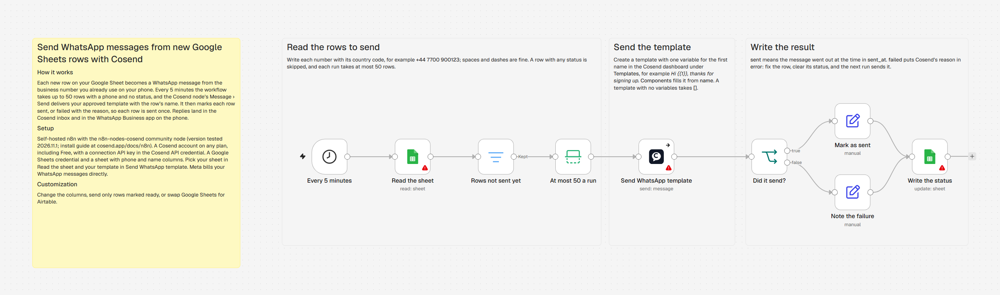
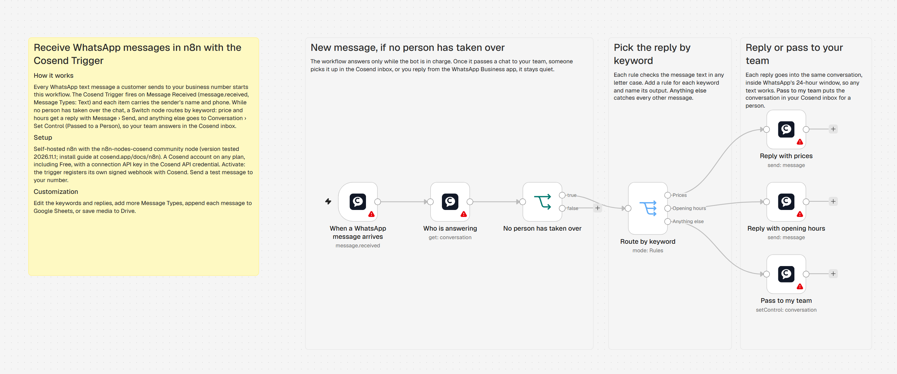
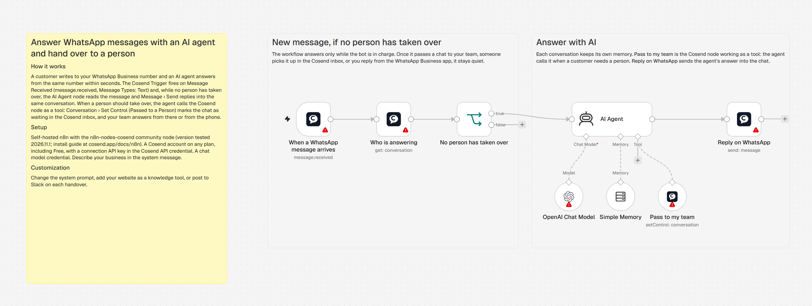
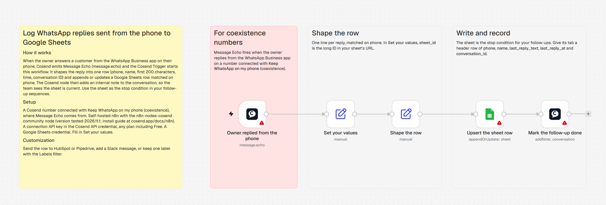
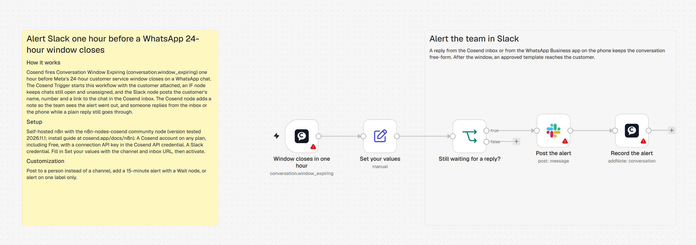

# Cosend workflow templates for n8n

Five ready-to-import n8n workflows built on the **Cosend** and **Cosend Trigger** nodes. Each one
carries sticky notes that walk you through setup on the canvas.

| Template | File | Starts with |
|---|---|---|
| [Google Sheets to WhatsApp](#google-sheets-to-whatsapp) | [`google-sheets-to-whatsapp.json`](./google-sheets-to-whatsapp.json) | Every 5 minutes, the rows not sent yet |
| [Receive WhatsApp messages](#receive-whatsapp-messages) | [`receive-whatsapp-messages.json`](./receive-whatsapp-messages.json) | A WhatsApp message |
| [WhatsApp AI agent](#whatsapp-ai-agent) | [`whatsapp-ai-agent.json`](./whatsapp-ai-agent.json) | A WhatsApp message |
| [Log phone replies to Google Sheets](#log-phone-replies-to-google-sheets) | [`log-phone-replies-to-google-sheets.json`](./log-phone-replies-to-google-sheets.json) | A reply sent from the WhatsApp Business app |
| [WhatsApp window alert to Slack](#whatsapp-window-alert-to-slack) | [`whatsapp-window-alert-to-slack.json`](./whatsapp-window-alert-to-slack.json) | One hour before a 24-hour window closes |

## Before you start

Every template needs:

- **The Cosend community node.** In n8n, an owner or admin opens **Settings > Community nodes >
  Install a community node** and enters `n8n-nodes-cosend`. n8n's
  [community node installation guide](https://docs.n8n.io/integrations/community-nodes/installation/)
  covers each step.
- **A Cosend API key.** In the [Cosend dashboard](https://dashboard.cosend.app), open
  **Settings > Developer > API keys** and create one. In n8n, add a **Cosend API** credential and
  paste it. A `cok_test_` or `csk_test_` key lets you build without sending live traffic.
- **A WhatsApp number connected to Cosend.**

Each template is tested with n8n-nodes-cosend 2026.11.1 (community node) on self-hosted n8n 2.47.3.
A picture of each workflow is in [`images/`](./images/), for when n8n's preview of a community node
does not render.

## How to import

Pick whichever suits you:

- **Paste.** Open the JSON file, copy all of it, and paste it onto an empty n8n canvas with
  Ctrl+V (Cmd+V on a Mac).
- **From a file.** Download the file, then in n8n open the workflow menu (**...**) and choose
  **Import from File**.
- **From a URL.** In the workflow menu choose **Import from URL** and paste the file's raw GitHub
  link, for example
  `https://raw.githubusercontent.com/cosendhq/n8n-nodes-cosend/main/templates/whatsapp-ai-agent.json`.
- **From the command line**, on a self-hosted instance:
  `n8n import:workflow --input=whatsapp-ai-agent.json`

Then open each node with a warning, pick your credential, and turn the workflow on.

## Google Sheets to WhatsApp

**What it does.** Every 5 minutes, each row of a Google Sheet with a phone number and no status
gets an approved WhatsApp template, with the row's name filled into the message. The workflow then
writes **sent** and the time into that row, or **failed** and Cosend's reason, so each row is sent
once and every result is in the sheet. Each run sends to at most 50 rows; the rest go in the next
run.

**What you need.**

- A Google account connected to n8n.
- A sheet with a header row of **phone** and **name**. Numbers carry their country code, for
  example `+44 7700 900123`; the workflow keeps the digits and adds the `+`. The workflow adds the
  **status**, **sent_at** and **error** columns the first time it writes.
- An approved WhatsApp template with one body variable for the first name. Create it in the
  Cosend dashboard under **Templates**. Meta reviews every template, and a decision can take up to
  24 hours, so create it first.

**How to import.** Import [`google-sheets-to-whatsapp.json`](./google-sheets-to-whatsapp.json),
pick your sheet from the list in **Read the sheet**, and pick the same Google account in **Write
the status**, which writes to that sheet. Then pick your template and its language in **Send
WhatsApp template**. A template without variables takes `[]` in **Components**. A connection key
already names the WhatsApp number that sends; with a workspace key, pick that number in
**Connection** too. To send a row again, clear its **status**.

## Receive WhatsApp messages

**What it does.** The Cosend Trigger starts the workflow for each text message your number
receives. A Switch node routes it by keyword: **price** gets your prices, **hours** gets your
opening hours, and every other message goes to your team in the Cosend inbox. The workflow answers
only while no person has taken over the chat, so once your team or the WhatsApp Business app
answers, it stays quiet.

**What you need.**

- An n8n instance Cosend can reach over the internet. Cosend registers the webhook when you turn
  the workflow on, so there is no URL to copy.

**How to import.** Import [`receive-whatsapp-messages.json`](./receive-whatsapp-messages.json),
pick your Cosend credential on each Cosend node, and edit the keywords and reply texts to match
your business. Add a rule to **Route by keyword** for each new keyword.

## WhatsApp AI agent

**What it does.** n8n's AI Agent answers each WhatsApp message in the same conversation. It keeps
a memory per conversation, and it has the Cosend node as a tool: when a customer asks for a
person, the agent passes the conversation to your team in the Cosend inbox and tells the customer
a person will reply. From then on the agent stays quiet in that chat, and it does the same when you
answer from the WhatsApp Business app.

**What you need.**

- An n8n instance Cosend can reach over the internet.
- A chat model credential. The template uses OpenAI; any chat model node fits the same slot.
- On self-hosted n8n 1.x, the environment variable `N8N_COMMUNITY_PACKAGES_ALLOW_TOOL_USAGE=true`,
  so the agent can use the Cosend node as a tool. Current n8n (tested on 2.46) offers it as a tool
  with no setting.

**How to import.** Import [`whatsapp-ai-agent.json`](./whatsapp-ai-agent.json), pick your Cosend
credential on **When a WhatsApp message arrives**, **Who is answering**, **Pass to my team** and
**Reply on WhatsApp**, add your model credential, and describe your business in the **AI Agent**
system message.

## Log phone replies to Google Sheets

**What it does.** When the owner answers a customer from the WhatsApp Business app on their phone,
Cosend sends **Message Echo** and the Cosend Trigger starts the workflow. It keeps one row per
customer in a Google Sheet, matched on the phone number, with **phone**, **name**,
**last_reply_text** (the first 200 characters of the reply), **last_reply_at** and
**conversation_id**. It then adds an internal note to the conversation in Cosend, so your team sees
the sheet is current. Use the sheet as the stop condition for your follow-ups: a customer the owner
answered from the phone gets no reminder.

**What you need.**

- A WhatsApp number connected to Cosend with **Keep WhatsApp on my phone** (coexistence). Message
  Echo comes from such a number.
- An n8n instance Cosend can reach over the internet.
- A Google account connected to n8n, and a sheet with a tab named **Replies** whose header row is
  **phone**, **name**, **last_reply_text**, **last_reply_at** and **conversation_id**.

**How to import.** Import
[`log-phone-replies-to-google-sheets.json`](./log-phone-replies-to-google-sheets.json) and fill in
**Set your values**: **sheet_id** is the long ID in your sheet's URL, **sheet_name** the tab, and
**max_text_length** how much of each reply to keep. Pick your Google account in **Upsert the sheet
row**, and your Cosend credential on **Owner replied from the phone** and **Mark the follow-up
done**. Then turn the workflow on.

## WhatsApp window alert to Slack

**What it does.** Cosend sends **Conversation Window Expiring** one hour before WhatsApp's 24-hour
customer service window closes on a chat. While the chat is still open and assigned to nobody, the
workflow posts the customer's name, number and a link to the chat in the Cosend inbox to a Slack
channel, then adds a note to the conversation saying the alert went out. A reply from the inbox or
from the WhatsApp Business app in that hour goes out as free-form text; after the window, an
approved template reaches the customer.

**What you need.**

- An n8n instance Cosend can reach over the internet.
- A Slack account connected to n8n, and a channel for the alerts.

**How to import.** Import
[`whatsapp-window-alert-to-slack.json`](./whatsapp-window-alert-to-slack.json), set
**slack_channel** in **Set your values**, pick your Slack account in **Post the alert**, and your
Cosend credential on **Window closes in one hour** and **Record the alert**. Then turn the workflow
on. **inbox_url** is the Cosend inbox, `https://dashboard.cosend.app/inbox/`, and the alert adds
the conversation ID to it, which opens that chat. Set **only_unassigned** to `false` to be alerted
about assigned chats too. To check that Cosend reaches your n8n, use **Send test** on the webhook in
the Cosend dashboard (**Settings > Webhooks**): the trigger answers the test event and starts no run.
